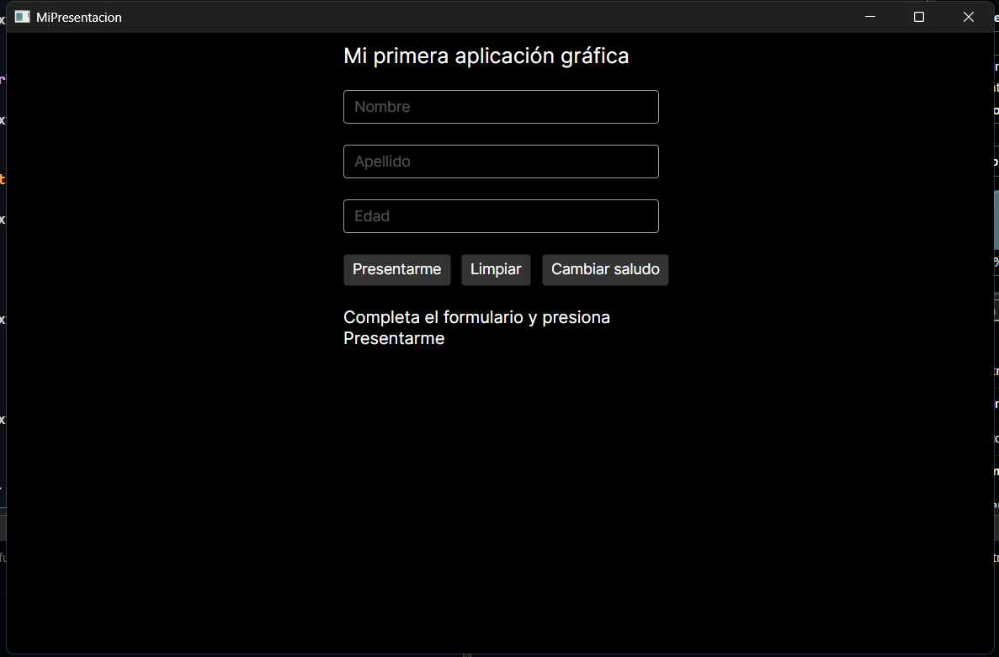
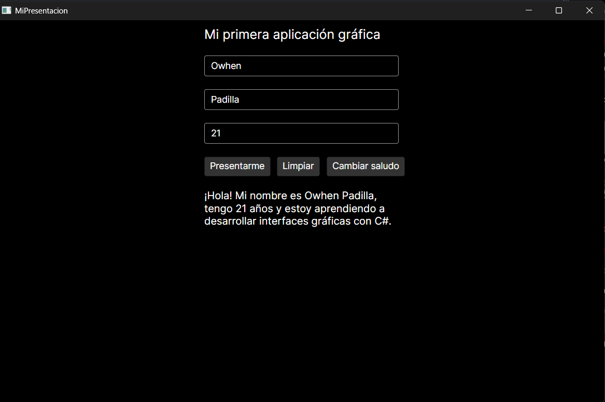
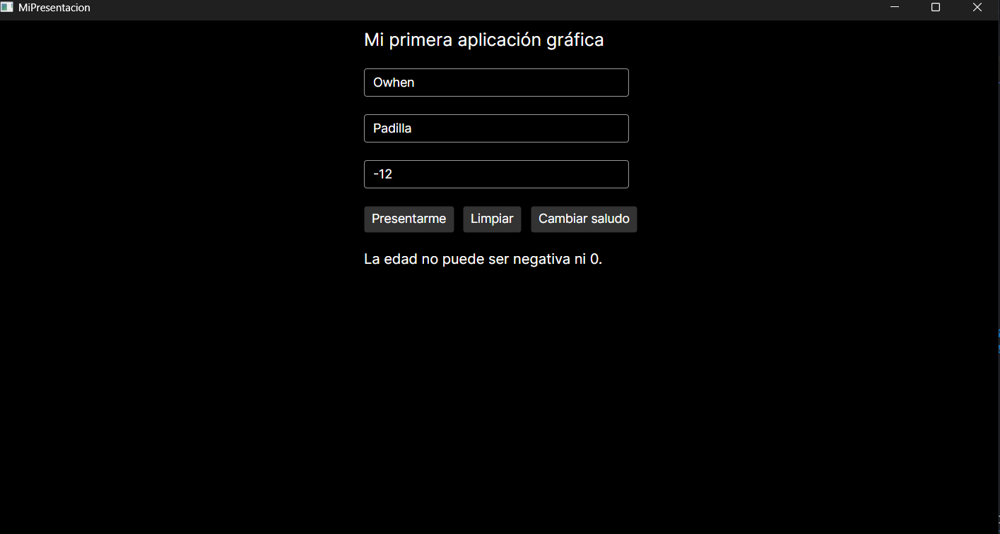

# MiPresentacion

Aplicación de escritorio desarrollada en **C#** con **Avalonia UI** que permite registrar los datos básicos de una persona (nombre, apellido y edad) y mostrar una presentación personalizada.

La aplicación valida la información introducida, muestra mensajes de advertencia cuando algún dato es incorrecto y permite alternar entre dos estilos de saludo sin reiniciar el programa.

## Tecnologías

- .NET 10
- Avalonia UI 12.1.2 (tema Fluent)
- XAML para la interfaz y C# para la lógica de eventos

## Controles utilizados

La interfaz está organizada con un `StackPanel` vertical principal (con `Margin`, `Spacing` y un ancho fijo centrado) y un `StackPanel` horizontal anidado para colocar los botones en una misma fila.

| Control | `x:Name` | Función |
|---|---|---|
| `TextBlock` | — | Muestra el título «Mi primera aplicación gráfica». No necesita nombre porque nunca cambia. |
| `TextBox` | `txtNombre` | Campo para escribir el nombre. |
| `TextBox` | `txtApellido` | Campo para escribir el apellido. |
| `TextBox` | `txtEdad` | Campo para escribir la edad. |
| `Button` | `btnPresentar` | Valida los datos y muestra la presentación. |
| `Button` | `btnLimpiar` | Restablece el formulario. |
| `Button` | `btnCambiar` | Alterna entre el saludo normal y el alternativo. |
| `TextBlock` | `blResultado` | Muestra el mensaje inicial, las advertencias o la presentación. Usa `TextWrapping="Wrap"` para que los mensajes largos no se corten. |

Cada `TextBox` usa `PlaceholderText` para indicar al usuario qué dato debe escribir.

## Funcionamiento de los eventos

Cada botón está conectado en `MainWindow.axaml` mediante el atributo `Click` a un método de `MainWindow.axaml.cs`.

### Presentarme → `BtnPresentar_Click`

Llama al método `MostrarPresentacion()`, que realiza las validaciones en orden. Cada validación que falla muestra su mensaje y detiene el método con `return` (cláusulas de guarda); solo si todas se superan se muestra la presentación.

1. Lee el nombre y el apellido usando `?.Trim() ?? ""`, para eliminar espacios sobrantes y evitar errores cuando el campo nunca se ha utilizado (`null`).
2. Comprueba con `string.IsNullOrWhiteSpace` que el nombre no esté vacío ni contenga solo espacios.
3. Hace la misma comprobación con el apellido.
4. Verifica con `int.TryParse` que la edad sea un número entero.
5. Rechaza las edades negativas o iguales a cero (`TryParse` acepta números como `-12`, por eso esta comprobación es necesaria).
6. Muestra el saludo que corresponda según el modo activo.

### Limpiar → `BtnLimpiar_Click`

- Vacía los tres campos del formulario.
- Restaura el mensaje inicial. Este mensaje se define una sola vez en el XAML y se guarda en el campo `mensajeInicial` al crear la ventana (justo después de `InitializeComponent()`), así no se repite el texto en dos lugares.
- Coloca de nuevo el cursor en el campo del nombre con `txtNombre.Focus()`.

### Cambiar saludo → `BtnCambiarSaludo_Click` (reto adicional)

- Invierte el valor del campo `bool esAlternativo` (`esAlternativo = !esAlternativo`), que funciona como la "memoria" de qué saludo debe mostrarse.
- Vuelve a llamar a `MostrarPresentacion()`, de modo que el saludo cambia al instante reutilizando las mismas validaciones, sin duplicar código.
- El modo elegido se mantiene aunque se pulse Limpiar.

## Casos de prueba

| Caso | Datos introducidos | Resultado obtenido |
|---|---|---|
| 1 | Nombre, apellido y edad válidos | Muestra la presentación |
| 2 | Nombre vacío | «Por favor, ingresa tu nombre.» |
| 3 | Apellido vacío | «Por favor, ingresa tu apellido.» |
| 4 | Edad con letras | «Por favor, ingresa una edad numérica válida.» |
| 5 | Edad negativa o igual a cero | «La edad no puede ser negativa ni 0.» |
| 6 | Presionar Limpiar | Campos vacíos, mensaje inicial restaurado y cursor en Nombre |

## Cómo ejecutar

**Requisito:** tener instalado el [SDK de .NET 10](https://dotnet.microsoft.com/download).

```bash
git clone https://github.com/AlXstorCode/MiPresentacion.git
cd MiPresentacion/MiPresentacion
dotnet run
```

El segundo `cd` es necesario porque el archivo del proyecto (`MiPresentacion.csproj`) está dentro de la subcarpeta `MiPresentacion/`.

## Capturas de pantalla

**Formulario inicial**



**Presentación correcta**



**Mensaje de validación (edad negativa)**



## Estructura del proyecto

```
MiPresentacion/
├── Img/                       Capturas de pantalla
├── MiPresentacion/
│   ├── Program.cs             Punto de entrada de la aplicación
│   ├── App.axaml              Configuración de la aplicación y tema
│   ├── App.axaml.cs
│   ├── MainWindow.axaml       Estructura visual de la ventana
│   ├── MainWindow.axaml.cs    Métodos que responden a los eventos
│   └── MiPresentacion.csproj
├── MiPresentacion.slnx
└── README.md
```

## Pregunta de reflexión

**¿Cuál es la función de `MainWindow.axaml` y `MainWindow.axaml.cs`, y cómo se relacionan mediante `x:Name` y los eventos `Click` para permitir que el usuario interactúe con la aplicación?**

En el archivo `.axaml` se encuentra la construcción visual del programa. Está escrito en XAML, un lenguaje de marcado, así que aquí no hay lógica, sino la estructura visual de la ventana: qué controles hay y cómo están organizados. En el `.axaml.cs` es donde se aloja la lógica en C#: la clase, los métodos y el funcionamiento del programa detrás de la ventana visual.

Cuando se le pone un `x:Name` a algún control del `.axaml` (por ejemplo, a un `TextBox`), el `.cs` lo reconoce por ese nombre, como si fuera una variable. Así, desde el código puedo leer lo que el usuario escribió en cada campo mediante su propiedad `Text` (que es un `string`) y también escribir mensajes en el `TextBlock` del resultado.

Los botones se conectan con el código mediante el atributo `Click`, que indica qué método del `.cs` se debe ejecutar cuando se presionan. Por ejemplo, al presionar Presentarme se ejecuta `BtnPresentar_Click`: el código lee los campos, hace todas las validaciones y, cuando se cumplen, muestra el mensaje con el texto guardado en dichos campos.
